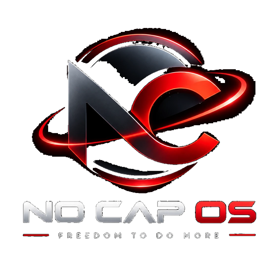
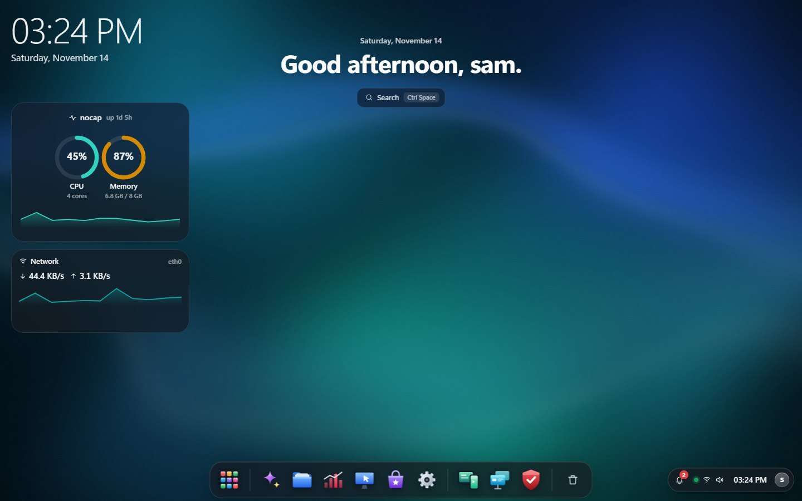
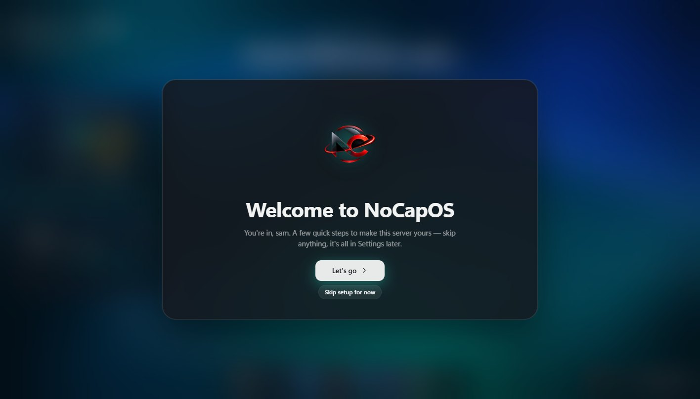
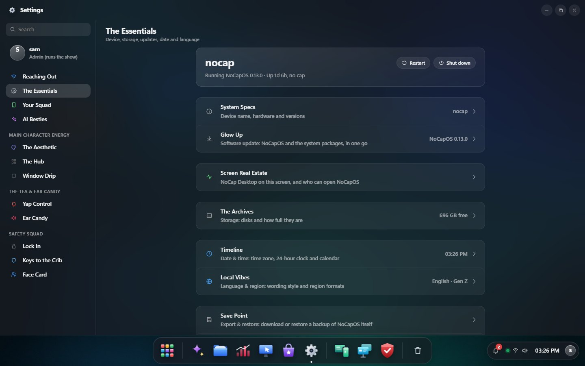
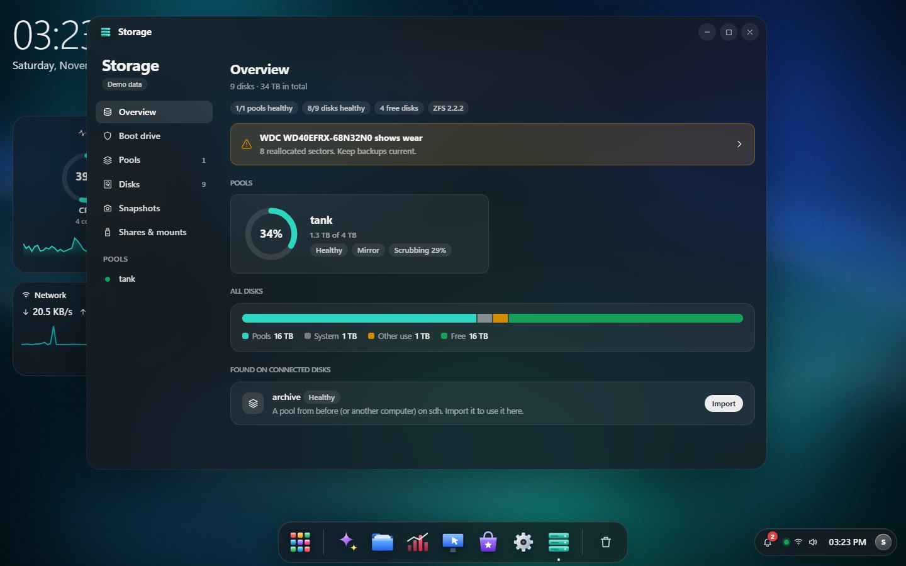
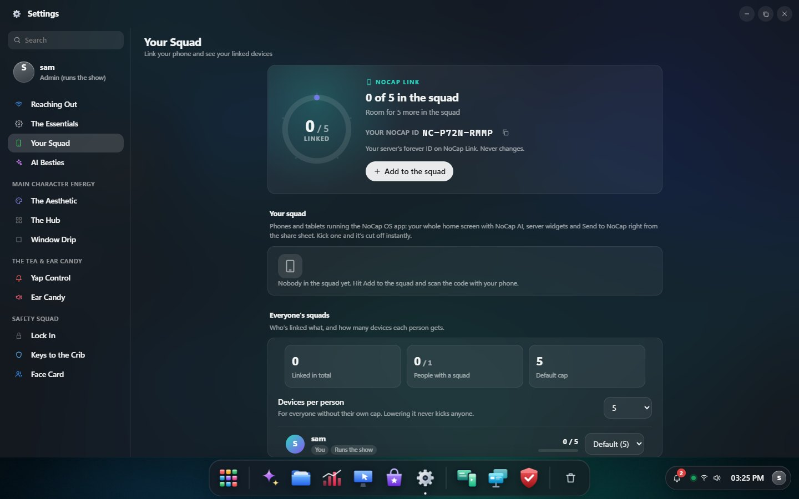
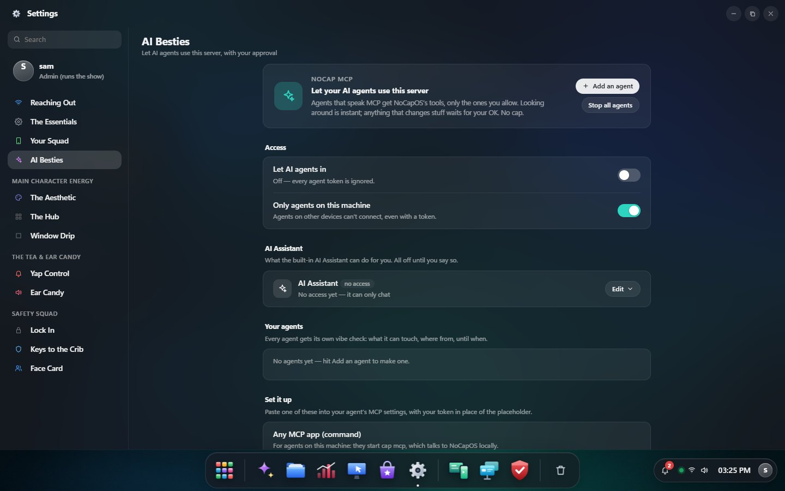
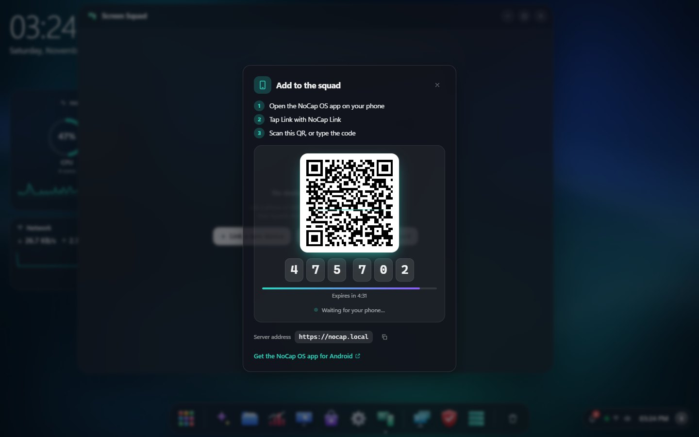

<p align="center"></p>

# NoCapOS

[](https://shatheitguy.github.io/nocapos/)
[](../../releases/latest)
[](https://github.com/shatheitguy/nocapos/actions/workflows/ci.yml)
[](LICENSE)

**Freedom to do more.** NoCapOS is a full Linux operating system built on Debian 13. The machine's
own screen runs a native NoCap Desktop, and any browser on your network gets the same OS as a web
desktop. Storage, security, virtual machines, apps, file sharing, backups and AI agents are built in,
and the NoCap OS phone app keeps your phone and your server connected.

🌐 **Website:** https://shatheitguy.github.io/nocapos/



## Download

| | |
|---|---|
| **PC installer (x86)** | `nocapos-<version>-amd64.iso` from [the latest release](https://github.com/shatheitguy/nocapos/releases/latest). Write it to a USB stick and boot: it starts the NoCap Desktop with an **Install NoCapOS** app. A text-mode installer is included for servers without a screen. |
| **Raspberry Pi image** | `nocapos-<version>-rpi-arm64.img.xz` from [the latest release](https://github.com/shatheitguy/nocapos/releases/latest). Flash it to an SD card or SSD for a Raspberry Pi 4 or 5. |
| **Phone app** | [`nocap-os.apk`](https://github.com/shatheitguy/nocapos/releases/latest/download/nocap-os.apk) |

Every download has a SHA-256 checksum next to it in the release. Kernel and security updates come
straight from Debian.

### Install on an existing system

Already running Debian, Ubuntu or Raspberry Pi OS (amd64, arm64, armv7)? Install NoCapOS on top:

```bash
curl -fsSL https://github.com/shatheitguy/nocapos/releases/latest/download/install.sh | sudo bash
```

The installer picks the build for your CPU, verifies its SHA-256 checksum, installs Docker if it is
missing (for the App Store) and sets NoCapOS up as the `nocapos` systemd service.

| Option | |
|---|---|
| `--storage DIR` | folder for NoCap Drive (default `/srv/nocapos`) |
| `--port N` | HTTPS port (default 443) |
| `--no-docker` / `--install-docker` | skip / don't ask about installing Docker |
| `--uninstall [--purge]` | remove NoCapOS; your files are never deleted |

### First start

Open the address shown on the screen from a device on your network (or use the NoCap Desktop) and
create your administrator. A short setup follows: voice, theme, name, network, time zone and updates;
skip anything and change it later in Settings. From outside your local network, setup also asks for a
one-time token.

### Updating

Updates are done from **Settings → Glow Up**: NoCapOS and the system packages, in one go. Accounts,
settings and files are kept.

## What you get

- **A full Linux OS** on Debian 13, for PCs and Raspberry Pi, with the same behaviour on amd64, arm64
  and armv7.
- **NoCap Desktop** on the physical screen, and the **web OS** from any browser: windows, dock, widgets,
  Files, Photos, Terminal, Settings, and a private space for each person.
- **Storage** — ZFS pools (mirror, RAIDZ1/2), snapshots with schedules, rollback and clones, encrypted
  folders, scrubs, disk health, cache drives and a mirrored boot drive. Erasing always needs a typed
  confirmation.
- **Shield** — a firewall with presets, a "what's exposed" view and anti-lockout, plus a DNS ad and
  tracker blocker for the whole network.
- **Virtual machines** — Virtual Desk with a step-by-step wizard, live usage, snapshots and each
  machine's screen in its own window.
- **App Store** — one-click self-hosted apps in Docker with updates and per-person access; edit
  containers, networks and Compose stacks.
- **File sharing** — Samba and WebDAV shared folders with Read & write / Read only / No access per
  person, guest shares, network drives and cloud folders.
- **Backups** — encrypted, scheduled backups to a drive, SFTP or S3-compatible storage, Rewind to any
  day, and export & restore of NoCapOS itself.
- **NoCap Link and the NoCap OS phone app** — always connected (nearby or remote), phone notifications
  and calls on the server, seamless clipboard both ways, send files and links (they land in your
  Received folder), Find my phone, Device Screens (see and control your phone's screen, asked every
  time), and finding and setting up NoCap servers from the phone.
- **AI Agents** — agents use the server over MCP (`cap mcp` or Streamable HTTP at `/mcp`) with a
  per-agent token and enforced permissions; anything that changes something waits for your approval.
  Off by default.
- **Two voices** — Gen Z (default) or Standard wording everywhere, in the phone app too.
- **Privacy** — NoCapOS and the phone app collect no data. Crash reports are sent only if you choose to.
- **Security** — argon2id passwords, two-factor sign-in, rotating sessions, an audit log of every admin
  action and a strict Content-Security-Policy.

## Screenshots

| | |
|---|---|
|  **First run** — create your account, then a quick setup |  **Settings** — everything in one place, updates included |
|  **Storage** — pools, disks, snapshots and the boot drive (sample data) |  **Linked devices** — who's linked and each person's limit |
|  **AI Agents** — MCP access with per-agent permissions |  **Link a phone** — scan the QR code or type the code |

## Build from source

Requirements: Go 1.25+, Node 20+.

```powershell
.\build.ps1                                   # UI + backend\bin\alfad.exe for this machine
.\package.ps1 -Version 0.4.0                  # Linux bundles in dist\ (amd64, arm64, armv7) + SHA256SUMS
```

```bash
cd frontend && npm install && npm run build   # builds the UI into backend/web/dist
cd ../backend && CGO_ENABLED=0 go build -o bin/alfad ./cmd/alfad
bash scripts/package.sh 0.4.0                 # (from the repo root) Linux bundles in dist/
```

Run it locally with `backend/bin/alfad` and open `http://127.0.0.1:8080`; the first start prints the
setup token. For UI work, `npm run dev` in `frontend/` proxies API calls to a running alfad.

## Layout

```
backend/            alfad — Go daemon, single static binary with the UI embedded
  internal/api        REST + WebSocket API
  internal/appstore   App Store catalog and installer
  internal/accounts   NoCapOS or Linux accounts
  internal/files      storage locations, recycle bin, archives, protection of system folders
  internal/photos     photo library, albums, Recently Deleted
  internal/backup     restic backups and Rewind
  internal/storage    disks, SMART and ZFS pools
  internal/netdrive   SMB/NFS mounts and SMB/WebDAV sharing
  internal/spaces     homes, shared-folder permissions, per-person app access
  internal/cloudimport rclone cloud folders
  internal/stacks     Docker Compose stacks
  internal/hostctl    network, Wi-Fi, power
  internal/docker     minimal Docker Engine API client
  internal/store      SQLite with migrations
frontend/           React + TypeScript + Vite desktop
deploy/             installer, systemd unit, Docker Compose files
```

## Security notes

- Native installs run as root on purpose, so NoCapOS can manage the machine. Everything that changes
  the system is admin-only and written to the audit log; turn on two-factor sign-in.
- Files refuses to delete, move or rename NoCapOS's own folders and core OS folders.
- App Store apps run as containers with their own volumes; uninstalling keeps data unless you choose
  to delete it.
- File links are short-lived tickets; files that could run script (HTML, SVG) always download instead
  of rendering.
- Signing in with two-factor authentication on takes the password, then a code from the
  authenticator app; each code works once. After 10 wrong passwords or codes in a row an account
  waits 15 minutes, whichever address the attempts come from.
- There is no password reset from the sign-in screen. An administrator resets passwords in
  Settings → Users & Groups. If you are the only administrator and are locked out, run on the
  server itself:

  ```
  sudo nocapos reset-password <user>
  ```

  It prints a temporary password, turns two-factor authentication off for that account and ends its
  sessions. Restart the service (`systemctl restart nocapos`) to lift a lockout right away.
- Everyone is signed out when the machine restarts.
- Made NoCapOS local-only and can't reach the server's own screen? On the server's console,
  `sudo cap web on` lets other devices back in.
- Settings → General → Export & Restore downloads a backup of NoCapOS's database and restores one
  (checked, then put in place at the next restart; the replaced database is kept next to it as
  `alfa.db.before-restore-<time>`).
- The Terminal's host shell runs as your own Linux account (use `sudo` for administration);
  administrators can open a root shell from the Terminal after re-entering their password.
- Choosing who can use an App Store app controls who sees it in NoCapOS, not network access to the
  app's own port.

## About the developer


**Sharqan Ahamed, Sha The IT Guy**: Senior IT Infrastructure Engineer and Cloud & Cybersecurity Strategist, Dubai, UAE.
NoCapOS is the home server I wanted: every tool I reach for, on hardware I own, behind one clean desktop.

[shatheitguy.in](https://shatheitguy.in) · [GitHub](https://github.com/shatheitguy) · [LinkedIn](https://ae.linkedin.com/in/sharqan-ahamed-8555b8169) · [YouTube](https://www.youtube.com/@shatheitguy) · [X](https://x.com/Sha_The_IT_Guy)

Also by me: [ALFA Launcher](https://github.com/shatheitguy/alfa-launcher), a sci-fi Android home screen, and [IT-Vault](https://github.com/shatheitguy/it-vault), a self-hosted IT asset register and helpdesk.

## License

NoCapOS is open source under the [MIT License](LICENSE). © 2026 Sharqan Ahamed (Sha The IT Guy).
